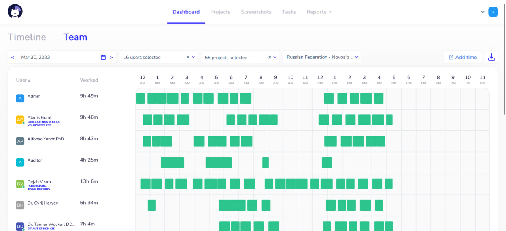
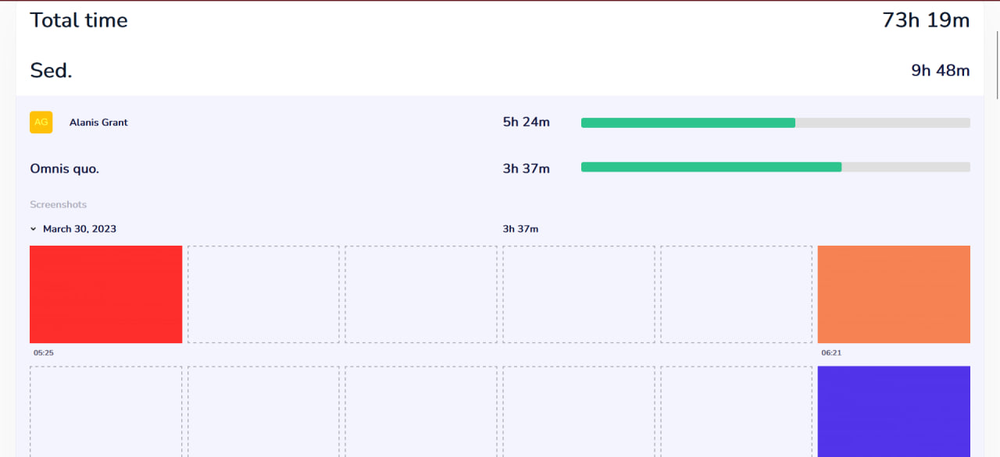

# Cattr

Self-hosted time tracking and project management platform with activity tracking,
screenshots, reports, and a public API.

[Website](https://cattr.app) ·
[Demo](https://demo.cattr.app) ·
[Documentation](https://cattr-app.github.io/server-application/) ·
[Discussions](https://github.com/orgs/cattr-app/discussions)

## Screenshots

|               Dashboard                |                  Project report                  |
|:--------------------------------------:|:------------------------------------------------:|
|  |  |

## Features

- Time tracking across projects and tasks
- Project and task management
- Screenshot and activity tracking
- Dashboard and configurable reports
- Offline synchronization
- Team, user, and role management
- Task comments and attachments
- Public API
- Extensible module system

## Try Cattr

A public demo is available at [demo.cattr.app](https://demo.cattr.app).

## Installation

Cattr is designed to run on your own infrastructure.

See the [installation guide](https://docs.cattr.app/#/en/getting-started/)
for requirements, deployment, and configuration.

Container images are published to:

`ghcr.io/cattr-app/server`

## API

Cattr provides an HTTP API for projects, tasks, users, time intervals,
screenshots, reports, company settings, attachments, and offline synchronization.

See the [API documentation](https://cattr-app.github.io/server-application/api/).

## Desktop application

The Cattr desktop client provides native time tracking and activity collection.

- [Source code](https://github.com/cattr-app/desktop-application)
- [Downloads](https://cattr.app/desktop/)

## Development

Interested in contributing or building Cattr locally?

See [CONTRIBUTING.md](./CONTRIBUTING.md) and the [developer guides](docs/developer/README.md).

Build the published API reference from the repository root:

```bash
pnpm install --frozen-lockfile
pnpm build:pages
```

## Modules

External backend and frontend modules are installed independently and are **disabled by
default**. Each one is switched on with its own environment variable:

```text
MODULE_BACKEND_<FLAG_NAME>_ENABLED=true     # backend module, <FLAG_NAME> from module.json "name"
MODULE_FRONTEND_<FLAG_NAME>_ENABLED=true    # frontend module, <FLAG_NAME> from ModuleConfig.moduleName
```

`<FLAG_NAME>` is the module identifier in upper snake case: a `_` is inserted before an
uppercase letter that follows a lowercase letter or a digit, any other separator becomes
`_`, and the result is uppercased (`CattrRedmineIntegration` -> `CATTR_REDMINE_INTEGRATION`,
`AmazingCat_RedmineIntegration` -> `AMAZING_CAT_REDMINE_INTEGRATION`, `Module2` -> `MODULE2`).
Only the exact value `true` enables a module. The full rules and examples are in
[docs/dev/module-activation-flags.md](docs/dev/module-activation-flags.md); installing
modules for development is described in [CONTRIBUTING.md](CONTRIBUTING.md#module-system).

The published Docker image contains no external modules, so the flags alone do nothing there;
build a custom image as described in
[Building an image with modules](CONTRIBUTING.md#building-an-image-with-modules).

## Documentation

- [User Guide](https://docs.cattr.app)
- [API Reference](https://cattr-app.github.io/server-application/api/)
- [Developer guides (English / Русский)](docs/developer/README.md)

## Community

For questions and general discussion, use
[GitHub Discussions](https://github.com/orgs/cattr-app/discussions).

For bugs and feature requests, use
[GitHub Issues](https://github.com/cattr-app/server-application/issues).

## License

Cattr Server is distributed under the
[Server Side Public License 1.0](./LICENSE).
